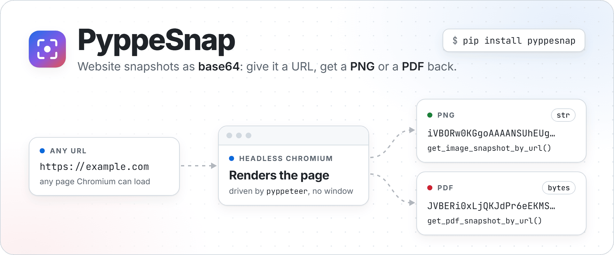
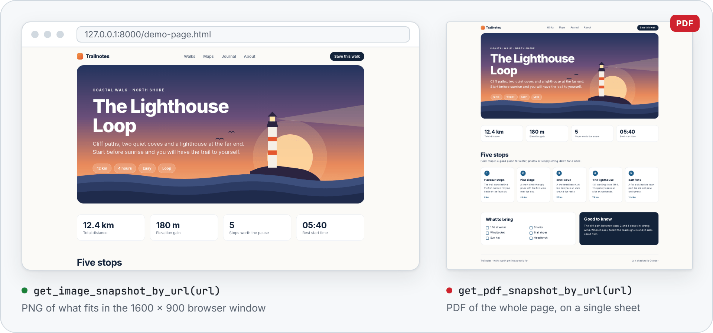
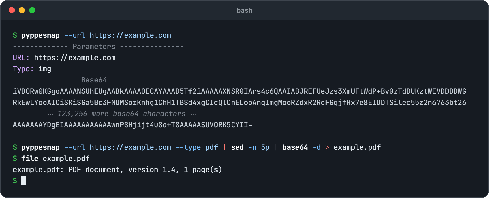

<p align="center">
  <picture>
    <source media="(prefers-color-scheme: dark)" srcset="docs/images/hero-dark.png">
    
  </picture>
</p>

<p align="center">
  <a href="https://github.com/NatLee/pyppeteer-snap/actions/workflows/test.yml"></a>
  <a href="https://pypi.org/project/PyppeSnap/"></a>
  <a href="https://pypi.org/project/PyppeSnap/"></a>
  <a href="https://github.com/NatLee/pyppeteer-snap/blob/main/LICENSE"></a>
</p>

PyppeSnap takes a snapshot of a web page and hands it to you as base64 text: a PNG of what fits in the
browser window, or a PDF of the whole page. It opens the page in a headless Chromium (no window) through
[Pyppeteer](https://github.com/pyppeteer/pyppeteer), so JavaScript-heavy pages render like they do in a
real browser. One function call, nothing written to disk: handy when the snapshot goes into JSON, a
database, an email or an ``.

## Installation

```bash
pip install pyppesnap
```

The package is called PyppeSnap [on PyPI](https://pypi.org/project/PyppeSnap/) and is imported as
`pyppesnap`. It works on Python 3.7–3.14.

**The first snapshot downloads Chromium.** Pyppeteer fetches its own Chromium build (about 100–200 MB)
into your user folder the first time, so that call takes a while and needs internet access. Later calls
take about a second.

On a minimal Linux image (for example `python:3.12-slim` in Docker) Chromium also needs some system
libraries. On Debian/Ubuntu:

```bash
apt-get install -y libnss3 libatk1.0-0 libatk-bridge2.0-0 libcups2 libdrm2 libxkbcommon0 \
  libxcomposite1 libxdamage1 libxfixes3 libxrandr2 libgbm1 libasound2 libpango-1.0-0 libcairo2
```

If they are missing, the snapshot fails with `Browser closed unexpectedly` and a hint pointing here.

## Quick start

```python
from pyppesnap import get_image_snapshot_by_url, get_pdf_snapshot_by_url

png = get_image_snapshot_by_url('https://example.com')  # PNG as base64 str
pdf = get_pdf_snapshot_by_url('https://example.com')    # PDF as base64 bytes

print(png[:20])  # iVBORw0KGgoAAAANSUhE
print(pdf[:20])  # b'JVBERi0xLjQKJdPr6eEK'
```

Here is what the two functions return for the same page (real output, decoded):

<p align="center">
  <picture>
    <source media="(prefers-color-scheme: dark)" srcset="docs/images/demo-dark.png">
    
  </picture>
</p>

## API

Both functions take the same arguments: `(url, width=1600, height=900, is_mobile=False)`.

| Function | Captures | Returns |
|---|---|---|
| `get_image_snapshot_by_url` | what fits in the `width` × `height` browser window | PNG as base64 `str` |
| `get_pdf_snapshot_by_url` | the whole page, laid out `width` pixels wide, on a single sheet | PDF as base64 `bytes` |

When a snapshot fails, both print the reason and return `None`.

- `url` needs its scheme: `https://example.com`, not `example.com`.
- `width` and `height` set the size of the browser window in CSS pixels.
- `is_mobile=True` makes Chromium honour the page's mobile viewport tag. Pair it with a phone-sized window,
  for example `width=390, height=844`.
- Each call starts its own Chromium and closes it again, even when something goes wrong.
- A page gets 30 seconds to load, and a whole snapshot 120 seconds (the first-run Chromium download does
  not count). To change them, set `pyppesnap.snapshot.NAVIGATION_TIMEOUT` and
  `pyppesnap.snapshot.SNAPSHOT_TIMEOUT` (in seconds).
- The functions are synchronous and also work where an event loop is already running, such as a Jupyter
  notebook. In async code, run them in a thread so they don't block your loop:
  `png = await asyncio.to_thread(get_image_snapshot_by_url, url)`.

## Save to a file or embed in HTML

```python
import base64
from pyppesnap import get_image_snapshot_by_url, get_pdf_snapshot_by_url

with open('page.png', 'wb') as f:
    f.write(base64.b64decode(get_image_snapshot_by_url('https://example.com')))
with open('page.pdf', 'wb') as f:
    f.write(base64.b64decode(get_pdf_snapshot_by_url('https://example.com')))

# Or show the PNG straight in a web page:
html = ''.format(get_image_snapshot_by_url('https://example.com'))
```

## Command line

<p align="center">
  
</p>

```bash
pyppesnap --url https://example.com              # PNG (the default, same as --type img)
pyppesnap --url https://example.com --type pdf   # PDF
```

Both types print plain base64 text on line 5, between the dashed lines, so you can save the file from the
shell:

```bash
pyppesnap --url https://example.com --type pdf | sed -n 5p | base64 -d > example.pdf
```

The exit status is 0 when it worked, 1 when the snapshot failed (the reason is printed), and 2 when
`--url` is missing or `--type` is not `img` or `pdf`.

## Use it in a web app

[`example/`](https://github.com/NatLee/pyppeteer-snap/tree/main/example) is a small Flask app: type a URL,
press a button, and the server returns the snapshot, which the page shows as an image or an inline PDF.

```bash
pip install pyppesnap flask
cd example
python main.py   # then open http://127.0.0.1:9898
```

Don't put it on the internet as it is: it opens any URL a visitor types, including addresses inside your
own network.

## Development

```bash
pip install -e ".[test]"
pytest tests      # most tests use a fake browser; a few take real snapshots of example.com,
                  # so they need internet access and Chromium
tox -e py         # what CI runs: check-manifest + tests
```

The README images are made from the HTML files in
[`docs/images/src/`](https://github.com/NatLee/pyppeteer-snap/tree/main/docs/images/src).
`take_demo_snapshots.py` takes the real snapshots with PyppeSnap; each HTML file says how to render it.

## License

[MIT](https://github.com/NatLee/pyppeteer-snap/blob/main/LICENSE)
